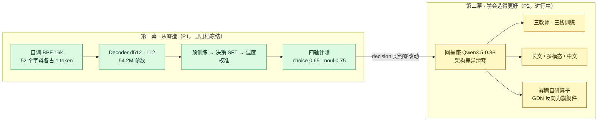
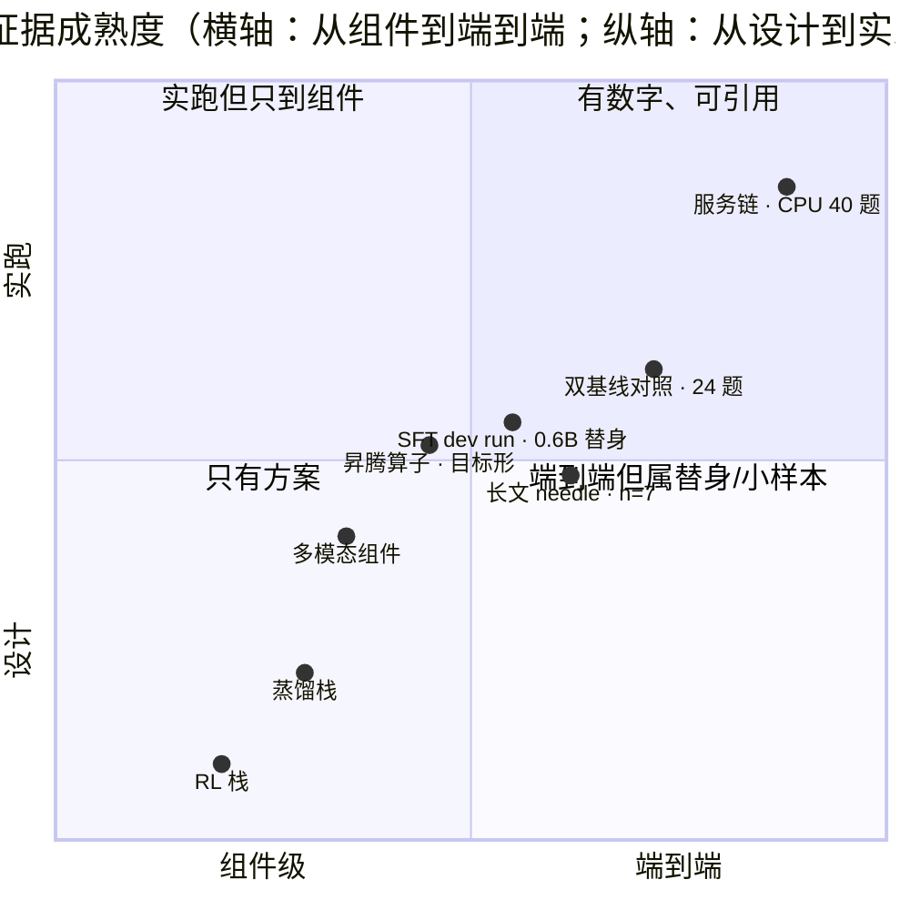
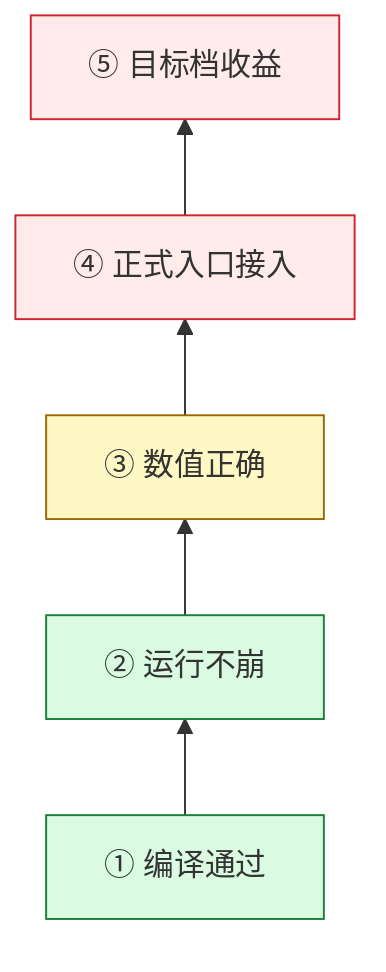
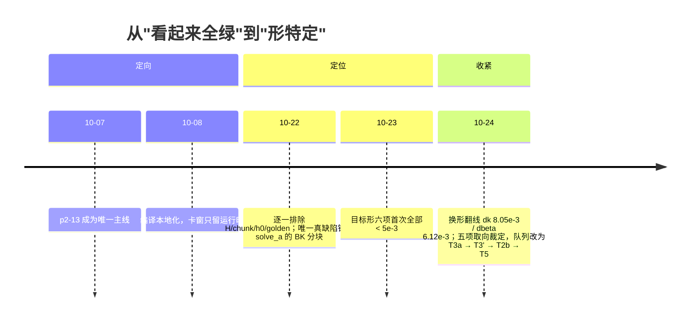

# System-One Study

> **一句话**：两幕学习项目——第一幕**从零**造出一个端侧决策引擎（禁任何第三方权重），第二幕在**同一基座**上用受控实验证明训练配方与自研算子到底值多少。
> **现在**：第一幕已归档闭环；第二幕进行中，**昇腾算子研究是当前主线**，训练栈与扩展实验挂起等资源。
> **诚信规则**：每个数字带出处，负结果与进展同强度；"设计定了"与"跑出来了"分开写。

[](https://github.com/SpellingDragon/system-one-study/actions/workflows/ci.yml)
[](https://github.com/SpellingDragon/system-one-study/actions/workflows/secrets-guard.yml)

## 30 秒

| | 结论 | 一句话证据 |
|---|---|---|
| **是什么** | 两幕教学项目 + 一份全程可审计的研究账 | 102 个 run 目录、13 个子域、23 篇文档 |
| **到哪了** | 第一幕已归档；第二幕三栈只跑通 SFT 的替身档，算子处于"编译绿、数值待卡" | 详见下方仪表盘 |
| **怎么读** | 3 分钟看本页；想懂原理走学习路径；想核数字走证据索引 | [三条路线](#三分钟的三条路线) |

## 全景



## 现状仪表盘

状态标签只有四种：**实跑**（有 run-id + 数字）、**部分**（组件或替身档）、**设计**（只有方案）、**未做**。

| 板块 | 状态 | 一句话现状 | 关键数字 / 出处 |
|---|---|---|---|
| P1 学习版 | **实跑** · 已归档 | 从零闭环，四轴可复现 | choice +31.67pp（n=40）、noul +25pp（n=60）；parity 20/20；P50 5.82ms（[run](scratch/runs/1006-eval-report-aa36/report.md)） |
| SFT 栈 | **部分** | 只有 0.6B 替身 + CPU tiny 档的 7 条 dev run | loss 1.958→1.261；正式 0.8B/910B 档待 C5（[p2-05](openspec/changes/teacher-p2-production-full/changes/p2-05-prod-sft/tasks.md) 5/8） |
| 蒸馏 / RL 栈 | **设计** / **未做** | 蒸馏无训练 run；RL 未落地 | 蒸馏 3/5 全是单测假件；RL 0/6（[p2-06](openspec/changes/teacher-p2-production-full/changes/p2-06-opd-gkd/tasks.md) · [p2-11](openspec/changes/teacher-p2-production-full/changes/p2-11-rl-rlcd/tasks.md)） |
| 扩展（长文/多模态/中文） | **部分** | 各有探针或组件，缺正式档对照 | needle 32K 命中 1/4（n=4）；多模态组件无生产消费者（[p2-07/08/09](openspec/changes/teacher-p2-production-full/changes/)） |
| 昇腾算子 | **部分** | 接口 9/9 编译绿；GDN 反向 kernelized；数值待卡 | 目标形六项历史读数 5.9e-4~4.7e-3，但换形翻线；生产链仍是标量核（[reassessment 04](docs/reassessment/04-ascend-gdn.md)） |
| 文档与评估 | **实跑** | 重评五批 + 零基础七章 + 统一证据索引 | V00–V13 逐条可复跑（[evidence](docs/reassessment/evidence.md)） |
| CI | **实跑** | 三门全绿 | P1 `278 passed` / P2 `343 passed`（2026-10-25 实测） |

## 三分钟的三条路线

| 你是 | 预算 | 先读 | 再读 | 读完能判断 |
|---|---|---|---|---|
| 只想知道值不值得看 | **3 分钟** | 本页「30 秒」+「诚实边界」两张表 | — | 这个项目有没有值得偷的东西 |
| 想学做模型 | **半天** | [学习路径](docs/learning_path/README.md) 第 1–3 章 | 第 4–6 章（教师/蒸馏/加速器） | 一次决策从数据到概率经过了什么，怎么验 |
| 来评审结果 | **30 分钟** | [全局评估](docs/reassessment/01-global-plan.md) | [证据索引](docs/reassessment/evidence.md) | 哪些数字能引用、哪些只是形特定或替身 |
| 接手工程 | **30 分钟** | [p2-13 现状](openspec/changes/teacher-p2-production-full/changes/p2-13-ascend-runtime/STATUS.md) | [下一轮建议](docs/reassessment/05-plan-recommendations.md) | 下一步做什么、什么被卡、为什么 |

## 第一幕：从零造（P1）

**结论**：在"禁止任何第三方预训练权重"的约束下，分词、模型、训练、读出、校准、评测整链跑通，且每一步都可复跑。

- 自训 16k BPE，**52 个字母各占 1 token**（A–Z = id 38..63）——全计划最大的单点，错一个字母整个读出就失效。
- Decoder `d=512 / L=12 / heads=8`，参数双口径 **54.2M 总 / 37.8M 非嵌入**。
- 终点不靠感觉：`repro_p1.sh` 一键串跑，四轴（质量/把握/一致/耗时）同 harness 出分。
- 数字都要带样本量读：choice 0.65 vs 随机 0.333（**n=40**），noul 0.75 vs 0.5（**n=60**）。

**四条用代价换来的教训**：

| 教训 | 当时发生了什么 |
|---|---|
| 字母必须单 token | 词表把字母切碎了，读出环节整体失效 |
| CPU 全绿 ≠ 设备可行 | swap-brain 用例在 MPS 一跑就漏出跨设备泄漏 |
| 同配置双跑会腰斩吞吐 | 编排者自己踩的雷，写进了方法论 |
| 写出来 ≠ 走得到 ≠ 快 | 内核 12/12 parity 绿，但正式前向因 mask 分支走回 eager；Metal 上热态比 torch 慢 2–6×，注入训练 −8.7% |

## 第二幕：学会造得更好（P2）

**结论**：四块设计都成立到"可演示"，但**只有服务链有端到端正面证据**；其余多为替身、组件或探针。



| 卡片 | 设计 | 现态（同强度写） |
|---|---|---|
| **三教师** | 文本 StartLux-4B + 视觉 GLM API + Qwen3.5-4B 备选 | 4B 权重 9.34GB 已下载但**从未载入**（内存守卫拦下）；训练里打分的全是 36.6M 随机初始化 **scaffold 替身**；视觉首波 14 次调用只落 2 行、颜色题 0/10 |
| **三栈** | SFT → 蒸馏 → RLCD | SFT 7 条 dev run 全走替身；蒸馏零训练 run；RLCD 未落地（0/6） |
| **昇腾算子** | 910B 自研 GDN 反向，替代 CUDA 生态 | 接口 9/9 编译绿、GDN 反向 kernelized；cube 面曾报 507015；**生产训练链只接了 LoRA 旁路**，backbone 仍是 HF 实现 |
| **边界实验** | 1M = 滑窗封顶 + GDN 线性记忆 + 门控短路 | 只有滑窗成件；适配器无训练 run、门控零实现，**1M 档零实测** |

## 我们怎么工作

**结论**：靠"证据阶梯 + 反模式清单 + 可复跑命令"三件套，而不是靠感觉。



> 阶梯的每一层都比上一层多一个前提：**绿了上一级，不能推出下一级**。本项目踩过的坑里，一半是"把①或③当成了⑤"。

- **多级 OpenSpec**：一级司编排、二级司领域、三级司孙任务；当前 13 子域 **72/117** 孙任务、3 个活跃变更（主计划 5/24、裁定落地 16/17、审计已完成）。
- **R 系列反模式**：每条都来自真实翻车（如"信汇报不复验""编辑工具假成功""逐波待令"），编号以 skill 为唯一源。
- **runs 四件套**：`config / metrics / notes / 结论行` 入库不删。**自查：102 个 run 里仍有 62 份 notes 带着"待填写"模板头**——这是流程失修，不是数据造假，清账列在卫生批。

## GDN 反向：90 天是怎么收敛的



**最有价值的三条经验**（完整复盘见[工程版](docs/reassessment/04-ascend-gdn.md)）：

1. **形特定必须写在结论里**：同一算子 T=512 通过、T=128 翻线，只报前者就是假绿。
2. **探针要自带对照，并先怀疑探针**：9 支自写探针里 4 支第一次就暴露自身缺陷。
3. **切换验证尺子会制造假结论**：把不同形状的 `max_abs` 与 `rel` 相除得出"改善 22 倍"，是混尺子的典型。

## 诚实边界

| 负结果 / 未完成 | 数字或状态 |
|---|---|
| 温度标定在正式档**恶化** | choice ECE 0.1175→**0.2267**，noul 0.1562→0.1682，报告"改善：否" |
| TileLang Metal 内核**慢于** torch-MPS | 单核 2–6×，训练 −8.7%，推理 −12%（M3 Pro / 0.1.15） |
| 长文曲线统计功效近零 | 32K 命中 1/4，128K 1 题 |
| 真教师从未前向 | 缓存里 0 行来自真 4B |
| GDN 换形翻线 | T=128 `dk` 8.049e-3；H=1/T8192 `dbeta` 6.116e-3 |
| 算子未接入训练 | v3 六梯无生产调用，生产走 `gdn_asc` 五梯 |
| 流程失修 | 62/102 份 notes 仍留"待填写"头 |

## 文档索引

| 文档 | 读它做什么 |
|---|---|
| [`docs/learning_path/`](docs/learning_path/README.md) | **零基础七章**：项目地图 → 张量与梯度 → P1 训练 → P2 蒸馏 → 实验证据 → 加速器/GDN → 反向专题；18 个 CPU 可跑实验 |
| [`docs/reassessment/`](docs/reassessment/README.md) | **2026-10-24 全项目重评**：计划审计、P1/P2/Ascend 三批证据复核、修订建议与裁定记录 |
| [`docs/teaching_gdn_bwd_verification.md`](docs/teaching_gdn_bwd_verification.md) | 算子"到底对不对"的判断方法（含一次完整排查的可跑演示；已勘误） |
| [`docs/reassessment/04-ascend-gdn.md`](docs/reassessment/04-ascend-gdn.md) | 同一件事的工程复盘：八次假绿、真缺陷三步定位、代价统计与误判清单 |
| [`release/ascend/port910b/README.md`](release/ascend/port910b/README.md) | 910B 兼容层接入说明（配 `INVENTORY.md`：950-only 依赖面穷举） |
| [`docs/compliance.md`](docs/compliance.md) | 对外权利推演与条款核验（**非法律意见**） |
| [`docs/ci_baseline_triage.md`](docs/ci_baseline_triage.md) | CI 红项三分归因台账 |

## 快速上手

```bash
# 第一幕（scratch，冻结只读）
cd scratch && python -m venv .venv && .venv/bin/pip install -e ".[dev]"
PYTHON=.venv/bin/python bash tools/ci.sh     # 四门禁：ruff / 注释 / 编译 / pytest

# 第二幕（release）
cd ../release && python -m venv .venv && .venv/bin/pip install -e ".[dev]"
.venv/bin/python -m pytest tests -q -m "not integration"

# 零基础教材的 18 个实验（不需要设备、不下载权重）
release/.venv/bin/python -P docs/learning_path/verify_examples.py --repeat 10
```

验收数字以**运行输出**为准，不引用历史快照：2026-10-25 实测 P1 `278 passed, 2 skipped, 41 deselected`、P2 `343 passed, 3 skipped, 3 deselected`。裸克隆缺 `bench/` 与权重是设计边界，脚本会以 exit 2 诚实拒跑而不是假装成功。

## 三条红线

1. 第一幕禁第三方权重；第二幕训练基座必须 Apache-2.0（StartLux 权重实为 CC BY-NC-4.0，仅限教师打分/verifier/对照评测）。
2. 一切跑分走同一 harness，双基线亲跑不引卡面；训练口只准吃 `axis: train`（守卫测试在册）。
3. `decision/` 契约零改动——程序即宪法，三层守护。

> 授权面声明（**非法律意见**）：本仓 `LICENSE` 的 MIT 仅覆盖本仓自写代码，不授予任何第三方模型权重/数据集权利；再分发产物需保留上游 NOTICE 与署名。权利推演见 [`docs/compliance.md`](docs/compliance.md)。
