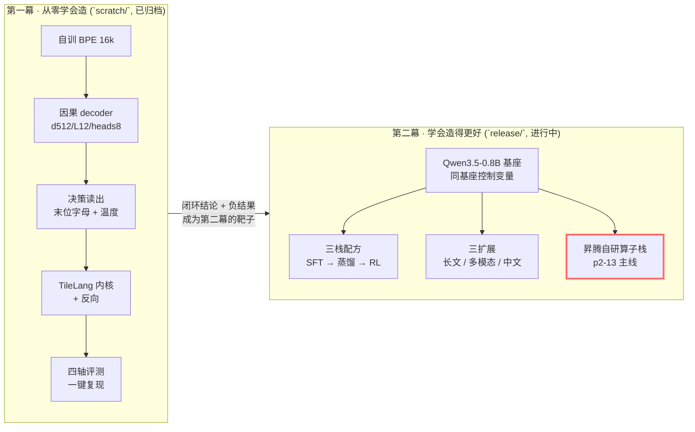
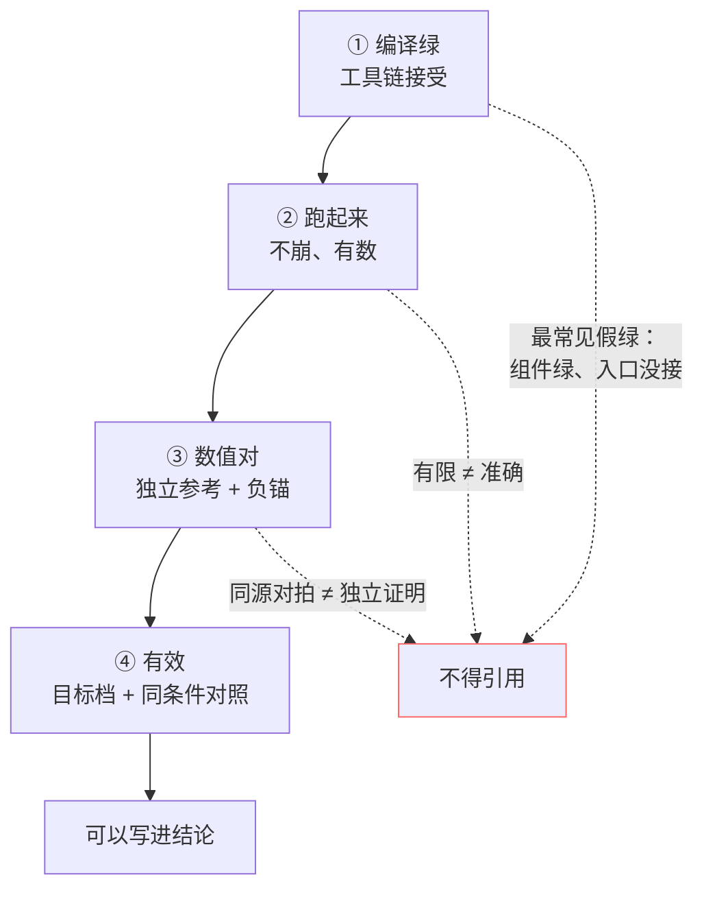

# System-One Study

[](https://github.com/SpellingDragon/system-one-study/actions/workflows/ci.yml)
[](https://github.com/SpellingDragon/system-one-study/actions/workflows/secrets-guard.yml)

> **一句话**：两幕学习项目 —— 第一幕**从零**造一个端侧决策引擎（禁第三方权重），第二幕**用受控实验**证明训练配方值多少。
> **现在**：第一幕已归档闭环；第二幕进行中，**昇腾算子研究是当前主线**，训练栈与扩展实验挂起等资源。

---

## 30 秒：现在到哪一步



| 板块 | 要回答的问题 | 现状 | 一条可复跑的证据 |
|---|---|---|---|
| **① 第一幕：从零** | 不借预训练权重，能不能造出会判断的小脑？ | **已归档**，工程闭环 | `bash scratch/examples/repro_p1.sh`（正式档：choice +31.67pp、noul +25.00pp、parity 20/20、P50 5.8ms；总参 54.2M / 非嵌入 37.8M；参考线是本仓自写的 +10pp 常数，非竞品基线；n=100（choice 40 / noul 60）、单种子） |
| **② 第二幕：训练配方** | 同基座下，三栈配方各值多少？ | **进行中**：SFT 只有 0.6B 替身 dev run（教师是 36.6M 随机 scaffold）；蒸馏零训练 run；RL 未落地 | `cd release && .venv/bin/python -m pytest tests -q -m "not integration"` |
| **③ 昇腾算子栈** | 自研 TileLang 算子能否进训练链？ | **编译通 / 数值欠 / 卡未上** | `bash scratch/tools/ci.sh` 绿；真机数值待卡窗（见 `docs/reassessment/04-ascend-gdn.md`） |
| **④ 扩展实验** | 长文 1M、多模态、中文各加多少？ | **约 1/3**：滑窗成件，适配器/门控未做；1M 零实测 | needle 曲线 run `1006-p2-07-a2-needle-curve-v3-1035`（7 条样本，方向性） |

> 第一幕另有四条教训，全部来自真实翻车：字母必须单 token（P1 自训词表 A–Z=38..63，P2 基座是另一套 32–57，编号不得互抄）、CPU 全绿≠设备可走（swap-brain 在 MPS 漏出跨设备泄漏）、同配置双跑吞吐腰斩、内核写出来≠走得到。逐条见 [02-p1-chain](docs/reassessment/02-p1-chain.md)。

---

## 3 分钟：三件最值得记住的事

> 都带负结果 —— 这是本项目第一产出，不是免责声明。

### 1. 内核"写出来"≠"走得到"≠"快"

内核可微四连在公开前向里**走不到**：`Decoder.forward` 无条件构造 visible 掩码（`model.py:386`），内核门在 `visible is not None` 时回退 eager（`model.py:211`）。即便接通，M3 Pro 上 TileLang 0.1.15 Metal 热态**全面慢于 torch-MPS 2–6×**：训练端到端 −8.7%（`1004-bench-kernel-autocograd-30step-28ba`）、推理 −12%（`1004-bench-infer-e2e-mps-ce64`）。

### 2. "校准"不保证变好 —— 正式档实测恶化

温度标定后 choice ECE **0.1175 → 0.2267**（Δ+0.1092）、noul 0.1562 → 0.1682，报告结论"改善：否"（run `1006-eval-report-aa36/report.md:12`）。tiny 链上的改善不能外推；同一份数据既拟合又报分，不算独立测试。

### 3. 算子"六项全绿"是**形特定**的，且≠已进生产

GDN 反向在目标形（B1 H16 T8192 DK128 DV128）六项 rel<5e-3，但换 H 或 chunk 数即翻线（`dk` 8.05e-3、`dbeta` 6.12e-3）；生产训练链实际消费的是另一套五梯度算子（`gdn_asc`），六梯度候选**尚未接入**。详见 [04-ascend-gdn](docs/reassessment/04-ascend-gdn.md)。

---

## 怎么判断"真的做成了"：四道门



本项目全站只用四种状态标签，读到它们就知道该信几分：

| 标签 | 含义 | 典型例 |
|---|---|---|
| **已证** | 目标档实测、有 run-id 与命令 | P1 四轴、CI 三门 |
| **部分** | 组件或替身档跑通，正式档未验 | SFT（0.6B 替身）、算子编译 9/9 |
| **未验** | 有实现/配置，但目标档没跑过 | fp32 算子档、1M 窗口 |
| **未实现** | 设计在册，代码不存在 | RL 栈（`rl_rlcd.py` 缺失）、门控短路 |

---

## 这个项目同时是一份工程方法记录

除技术产物外，仓库本身就是 **agent 驱动软件工程**的活教材：多级 OpenSpec 变更（一级司编排、二级司领域、三级司执行）、子 agent 五段战报与完成度五查、计划缺陷回写闭环、`runs/` 证据文化（run 不删，连空跑的壳也留着）。现态：第一幕 10 子域 66/66 已归档；第二幕 13 子域远未收口（p2-11 RL、p2-12 报告为零）。自家规矩也照到自己身上：曾实测 93 个 run 目录里 77 个 notes 残留"待填写"模板头——属流程失修，不靠门面遮丑。

入口：[`AGENTS.md`](AGENTS.md)（仓库纪律）、[`.agent/skills/openspec-multilevel-planning/`](.agent/skills/openspec-multilevel-planning/SKILL.md)（规划—执行—验收方法论，R 系列反模式编号的唯一源）、[`openspec/changes/`](openspec/changes/)（两幕计划与整改账）。

---

## 3 分钟 / 30 分钟 / 半天：阅读路径

| 时间 | 读什么 | 得到什么 |
|---|---|---|
| **3 min** | 本页（到这一行为止） | 项目在做什么、到哪一步、该信几分 |
| **30 min** | [学习路径](docs/learning_path/README.md) 第 1–2 章 + 第 6 章 | 一次决策的完整数据流；张量/梯度；算子为何难 |
| **半天** | [技术重评](docs/reassessment/README.md) → [P1](docs/reassessment/02-p1-chain.md) / [P2](docs/reassessment/03-p2-chain.md) / [算子](docs/reassessment/04-ascend-gdn.md) → [修订建议](docs/reassessment/05-plan-recommendations.md) | 每条的原始证据、红项归属、下一轮取舍 |

---

## 文档索引

| 文档 | 用途 |
|---|---|
| [`docs/learning_path/`](docs/learning_path/README.md) | 零基础六章教材：项目地图 → 张量梯度 → P1 → P2 → 实验证据 → 加速器；18 个 CPU 实验可复跑 |
| [`docs/reassessment/`](docs/reassessment/README.md) | 2026-10-24 全项目重评：四批评估 + 证据索引（V00–V13）+ 已裁定修订建议 |
| [`docs/teaching_gdn_bwd_verification.md`](docs/teaching_gdn_bwd_verification.md) | GDN 反向专题教材：怎么判断一个算子对不对；含可跑实验与自测（已勘误） |
| [`docs/compliance.md`](docs/compliance.md) | 对外权利推演（**非法律意见**）；[`docs/ci_baseline_triage.md`](docs/ci_baseline_triage.md) 为 CI 红项归因台账 |
| [`openspec/changes/audit-remediation-1010/N_traceability.md`](openspec/changes/audit-remediation-1010/N_traceability.md) | 门面数字的逐条溯源表（含已作废的旧口径） |

---

## 快速上手

```bash
# 第一幕（scratch，CPU 全门）
cd scratch && python -m venv .venv && .venv/bin/pip install -e ".[dev]"
PYTHON=.venv/bin/python bash tools/ci.sh          # ruff + 注释门 + 编译 + pytest
bash examples/repro_p1.sh                         # 需自备语料；缺件会在阶段 0 exit 2 拒跑

# 第二幕（release）
cd ../release && python -m venv .venv && .venv/bin/pip install -e ".[dev]"
.venv/bin/python -m pytest tests -q -m "not integration"
```

验收以运行输出为准，不引用历史快照数；Linux/CI 与 macOS 的数字不可互抄（MPS-only 用例跨环境口径不同）。

---

## 三条红线

1. **第一幕禁第三方权重**；第二幕基座必须 Apache 2.0 —— 教师权重 CC BY-NC-4.0 只可用于打分/判分/对照评测。
2. **跑分只走同一 harness**；训练口只准吃 `axis: train`（守卫：`release/tests/test_train_axis_guard.py`，覆盖 SFT 与 OPD 两个入口）。
3. **`sys1/decision/` 契约零改动** —— 程序即宪法，三层守护。

> **授权面（非法律意见）**：本仓 MIT 仅覆盖自写代码，不授予任何第三方权重/数据集权利（教师 CC BY-NC-4.0，底座 Apache-2.0 含上游 NOTICE 血缘）。详见 [`docs/compliance.md`](docs/compliance.md)。
