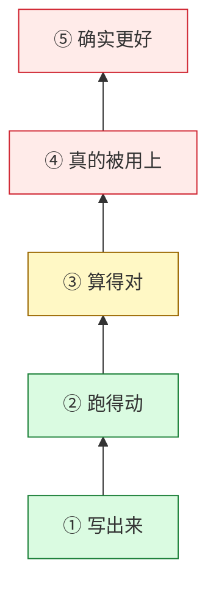

# System-One Study

> 你将从零造出一个会「做选择」的小模型：自己训词表、自己写模型、自己训练、自己判定它行不行。
> 然后你会学一件更重要的事——**怎么证明你的结果是真的**。
>
> 只需要一台笔记本和 Python。不需要显卡、不需要第三方权重、不需要先学过深度学习。

## 30 秒：这里能干什么

| | 内容 |
|---|---|
| **你会亲手做** | 分词器 → 因果模型 → 预训练 → 决策微调 → 温度校准 → 评测，全链自己写 |
| **你会学会判断** | 一个数字什么时候可信、什么时候是「假绿」，以及为什么自己写的测试也会骗自己 |

## 从这里开始（三步，约 20 分钟）

```bash
# 1) 拿到仓库
git clone https://github.com/SpellingDragon/system-one-study.git && cd system-one-study

# 2) 装依赖（主要是 torch / numpy）
cd release && python -m venv .venv && .venv/bin/pip install -e ".[dev]"

# 3) 回到仓库根，跑教材里的全部小实验（18 个，CPU，秒级）
cd .. && release/.venv/bin/python -P docs/learning_path/verify_examples.py --repeat 3
```

然后打开 [学习路径](docs/learning_path/README.md)，从第 1 章开始读。

## 学习地图


书里每一章对应上图的一段，或对应「怎么知道这一段是对的」：

| 章 | 一句话 | 你会动手做什么 | 约 |
|---|---|---|---|
| [1 项目地图](docs/learning_path/01-project-map.md) | 一次决策从输入到答案走了哪些环节 | 分清训练/推理/评测，看懂一条实验记录 | 20 分钟 |
| [2 张量与梯度](docs/learning_path/02-tensors-and-gradients.md) | 读懂模型代码所需的全部数学 | 手算一个线性层的梯度，用三种方法互相对账；观察「切片之后不再连续」 | 40 分钟 |
| [3 P1：训练与读出](docs/learning_path/03-p1-training-and-decisions.md) | 从零训练一个能答题的小模型 | 算 softmax 与温度，理解为什么校准可能让结果变差 | 40 分钟 |
| [4 P2：教师与蒸馏](docs/learning_path/04-p2-teachers-and-training.md) | 让大模型教小模型 | 手算两个方向的 KL，看它们为何不相等；验证 LoRA 初始不改变输出 | 45 分钟 |
| [5 实验证据](docs/learning_path/05-experimental-evidence.md) | 怎样判断一个数字是真是假 | 构造「最大误差相同、命中率一个 0.999 一个 0.001」的反例 | 40 分钟 |
| [6 加速器与算子](docs/learning_path/06-accelerators-and-kernels.md) | 为什么「算得对」仍然很难 | 手推分块矩阵乘；亲手做一次状态递推；看补齐 token 为何不改变结果 | 60 分钟 |
| [7 GDN 反向专题](docs/teaching_gdn_bwd_verification.md) | 一次真实的算子排查怎么走 | 用三把尺子量同一个算子，学会先怀疑自己的探针 | 90 分钟 |

## 你会遇到的四个真问题

这些不是课本上的注意事项，而是本项目真实踩过、并写进教材的坑：

1. **「测试全绿」说明不了太多**。要问：测的是哪条路径、什么输入、哪个版本。
2. **「跑得动」不等于「算得对」，更不等于「真的用上」**。中间隔着一层一层的门。
3. **换一把尺子量，会得出相反的结论**。误差、命中率、耗时，必须说清口径才能比较。
4. **你的检测手段本身可能是错的**。所以每个实验都要带一个「已知答案是对的」的对照组。



> 每往上一层，都多一个前提。**上一层的绿，推不出下一层。**

## 想找什么

| 你想 | 去哪 |
|---|---|
| 从头学 | [学习路径](docs/learning_path/README.md)（七章，按上表顺序） |
| 直接看代码怎么写 | `scratch/sys1/`（模型与决策）、`scratch/learning/`（训练脚本） |
| 看别人怎么踩坑 | 各章末尾的「真实困难」小节 + [GDN 专题](docs/teaching_gdn_bwd_verification.md) |

---

全部内容自己写（不用任何预训练权重）；所有跑分亲自跑在同一个评测上，不引用别人的榜单数字。