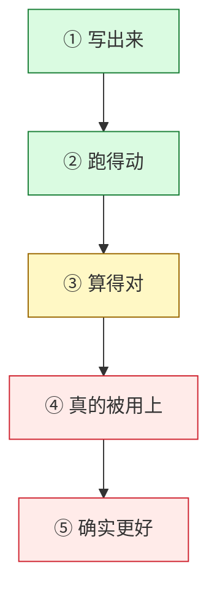

# System-One Study

> 你将从零造出一个会「做选择」的小模型：自己训词表、自己写模型、自己训练、自己判定它行不行。
> 然后你会学一件更重要的事——**怎么证明你的结果是真的**。
>
> 只需要一台笔记本和 Python。不需要显卡、不需要第三方权重、不需要先学过深度学习。

## 30 秒：这里能干什么

| | 内容 |
|---|---|
| **你会亲手做** | 分词器 → 因果模型 → 预训练 → 决策微调 → 温度校准 → 评测，全链自己写 |
| **你会学会判断** | 一个数字什么时候可信、什么时候是「假绿」，以及为什么自己写的测试也会骗自己 |

## 从这里开始（三步，约 20 分钟）

```bash
# 1) 拿到仓库
git clone https://github.com/SpellingDragon/system-one-study.git && cd system-one-study

# 2) 装依赖（主要是 torch / numpy）
cd release && python -m venv .venv && .venv/bin/pip install -e ".[dev]"

# 3) 回到仓库根，跑教材里的全部小实验（18 个，CPU，秒级）
cd .. && release/.venv/bin/python -P docs/learning_path/verify_examples.py --repeat 3
```

然后打开 [学习路径](docs/learning_path/README.md)，从第 1 章开始读。

## 学习地图


## 两幕怎么分工

- **第一幕（第 1–3 章）**：不借任何预训练权重，从零造出全链——你会真懂每一层在做什么。
- **第二幕（第 4、6 章）**：换一个更强的现成基座，把它做得更好——预期与现态见本节下方。
- **第 5、7 章不属于任何一幕**：它们是判断力的训练——第 5 章教你怎么怀疑一个数字，第 7 章用一次真实排查把方法完整走一遍。

每一章对应上图的一段，或对应「怎么知道这一段是对的」：

| 章 | 一句话 | 你会动手做什么 | 约 |
|---|---|---|---|
| [1 项目地图](docs/learning_path/01-project-map.md) | 一次决策从输入到答案走了哪些环节 | 分清训练/推理/评测，看懂一条实验记录 | 20 分钟 |
| [2 张量与梯度](docs/learning_path/02-tensors-and-gradients.md) | 读懂模型代码所需的全部数学 | 手算一个线性层的梯度，用三种方法互相对账；观察「切片之后不再连续」 | 40 分钟 |
| [3 P1：训练与读出](docs/learning_path/03-p1-training-and-decisions.md) | 从零训练一个能答题的小模型 | 算 softmax 与温度，理解为什么校准可能让结果变差 | 40 分钟 |
| [4 P2：教师与蒸馏](docs/learning_path/04-p2-teachers-and-training.md) | 让大模型教小模型 | 手算两个方向的 KL，看它们为何不相等；验证 LoRA 初始不改变输出 | 45 分钟 |
| [5 实验证据](docs/learning_path/05-experimental-evidence.md) | 怎样判断一个数字是真是假 | 构造「最大误差相同、命中率一个 0.999 一个 0.001」的反例 | 40 分钟 |
| [6 加速器与算子](docs/learning_path/06-accelerators-and-kernels.md) | 为什么「算得对」仍然很难 | 手推分块矩阵乘；亲手做一次状态递推；看补齐 token 为何不改变结果 | 60 分钟 |
| [7 GDN 反向专题](docs/teaching_gdn_bwd_verification.md) | 一次真实的算子排查怎么走 | 用三把尺子量同一个算子，学会先怀疑自己的探针 | 90 分钟 |

## 第二幕：预期、做到、学到

> 这一段写给**已经会训模型、想把它做成可信结论**的人。只想入门，从 [学习路径](docs/learning_path/README.md) 第 1 章开始。

**预期**（它要回答的三个技术问题）

1. 同一个基座、**只换训练配方**，能提升多少？（控制变量）
2. 让 4B 级教师把知识压进 0.8B 学生，可行吗？（蒸馏）
3. 把算子从 CUDA 生态搬到昇腾 NPU，正确性与速度各付什么代价？（算子）

**做到**（按环节，只说技术事实）

| 环节 | 状态 | 说明 |
|---|---|---|
| 载入与接线 | 通 | 0.8B 真载入 + 换脑校验；LoRA 注入与混合栈一步在 host CPU 跑通（loss 0.911→0.824，15 枚梯度均非 None） |
| 蒸馏管线 | 通，教师用替身 | 采样 → 教师分布 → KL 的代码与单测齐；真 4B 教师因内存未载入，管线用**同架构随机权重替身**调通 |
| 长文 | 半 | 8K / 32K / 128K 分别只跑了 2 / 4 / 1 题，样本太少，只能算方向性读数 |
| 多模态 | 半 | processor 与视觉塔探针通（448² → 196 token），缺「加图 / 去图」对照 |
| 算子 | 编译通、数值待验 | 接口 9/9 编译通过；GDN 反向在目标形状历史读数 <5e-3，**换形状会翻线**；另有一条更慢但正确的标量路 |
| 服务 | 通（CPU） | 40 题 endpoint 与本地逐题一致，P50 ≈ 0.38 s |

**学到**（在 P2 里能练到的六项技术，每项都能在仓库里找到落点）

| 练什么 | 落在哪 |
|---|---|
| 软标签读出：只对候选字母行算交叉熵，硬标签与教师分布按比例混合 | `release/production/sft.py` 的读出位 CE |
| 选项级蒸馏循环：学生采样候选子集 → 教师在同一子集上重归一 → 逐候选散度 → 周期性重采 | `release/production/opd.py` |
| 把教师打分做成资产：离线产分布 + `model_id + prompt + 候选集` 三元键，替身与真教师物理隔离 | `release/production/teachers/cache.py` |
| LoRA 与梯度检查点组合，并在真基座上跑通完整一步 | `release/production/sft.py`、`release/ascend/train_step.py` |
| 跨后端一致评测：同输入、同 harness，同时报准确率、ECE、延迟与 argmax 一致率 | `release/sys1/eval/` |
| 一个算子的六层验收：编译 → 运行 → 有限 → 精度 → 形状覆盖 → 接入 | `release/ascend/`、[GDN 专题](docs/teaching_gdn_bwd_verification.md) |

## 你会遇到的四个真问题

这些不是课本上的注意事项，而是本项目真实踩过、并写进教材的坑：

1. **「测试全绿」说明不了太多**。要问：测的是哪条路径、什么输入、哪个版本。本项目 9 支自写探针里，4 支第一次跑就暴露自身缺陷。
2. **「跑得动」不等于「算得对」，更不等于「真的用上」**。内核 12/12 对拍绿，但正式前向因一个 mask 分支始终走回 eager。
3. **换一把尺子量，会得出相反的结论**。把不同形状的 `max_abs` 与 `rel` 相除，曾得出「改善 7~22 倍」。
4. **你的检测手段本身可能是错的**。同一批里 CONTROL 反而 FAIL、目标形却 PASS——先查尺子，再查被测件。



> 每往上一层，都多一个前提。**上一层的绿，推不出下一层。**

## 想找什么

| 你想 | 去哪 |
|---|---|
| 从头学 | [学习路径](docs/learning_path/README.md)（七章，按上表顺序） |
| 直接看代码怎么写 | `scratch/sys1/`（模型与决策）、`scratch/learning/`（训练脚本） |
| 看别人怎么踩坑 | 各章末尾的「真实困难」小节 + [GDN 专题](docs/teaching_gdn_bwd_verification.md) |

---

全部内容自己写（不用任何预训练权重）；所有跑分亲自跑在同一个评测上，不引用别人的榜单数字。